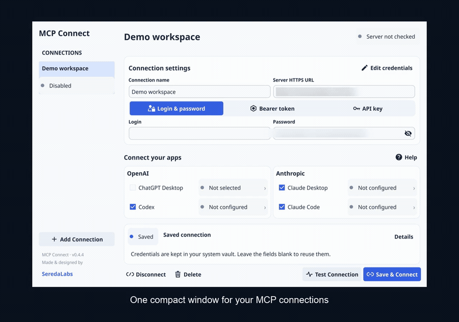

<h1>
  MCP Connect
  
  
</h1>

### 🔌 Your MCP servers, connected to the apps you use.

MCP Connect is a compact desktop utility for connecting AI clients to HTTPS MCP servers. Enter your server and credentials, choose your apps, and connect. Secrets stay in your operating system's secure store; the client starts the adapter when needed.

**Use the app:** [Download](https://github.com/SeredaLabs/mcp-connect/releases) · [Setup](#get-connected) · [Authentication](docs/AUTHENTICATION.md)

**Project:** [Security](SECURITY.md) · [Build from source](docs/BUILD.md)

## See it in action

Connection profiles → login & password / Bearer token / API key → AI client selection. The GIF loops automatically; server addresses and credential fields are blurred. Demonstration data only, without a live server connection.

[▶ Watch or download the full MP4 demo](assets/demo/mcp-connect-demo.mp4)

## Why MCP Connect?

- **One compact window.** Connection profiles, authentication and client status in one place.
- **Three authentication methods.** Login & password, Bearer token or API key.
- **System credential storage.** macOS Keychain, Windows Credential Manager or Linux Secret Service.
- **No background service.** The adapter runs on demand; the packaged utility needs no Go, Node or Python runtime.

## Get connected

1. Download the package for your OS and processor from [Releases](https://github.com/SeredaLabs/mcp-connect/releases).
2. Extract it into a permanent location and open **MCP Connect**.
3. Enter a connection name and the final **HTTPS MCP endpoint**.
4. Choose an authentication method and enter your credentials locally.
5. Select your installed clients, then **Test Connection** and **Save & Connect**.
6. Restart the clients and start a new chat.

**Test Connection** checks the MCP handshake and lists tools without invoking business tools. Click a client status badge to open its settings or setup guidance.

## Supported clients

| Provider | Client | Connection |
|---|---|---|
| OpenAI | Codex | Local MCP registration through its installed CLI |
| OpenAI | ChatGPT Desktop | Local plugin in a chat with local execution |
| Anthropic | Claude Desktop | Local desktop MCP configuration |
| Anthropic | Claude Code | Local MCP registration through its installed CLI |

Each client has its own OS support and availability. The ChatGPT integration needs a compatible bundled or installed Codex CLI. A local plugin does not automatically appear in ordinary browser or mobile chats.

## Platforms

| Platform | Processor | Package |
|---|---|---|
| macOS 13+ | Apple Silicon / Intel | `.app` in ZIP |
| Windows | AMD64 / ARM64 | `.exe` in ZIP |
| Linux desktop | AMD64 / ARM64 | `.tar.gz` |

A graphical session and OpenGL 2.1 compatible graphics drivers are required. Linux packages target Ubuntu 24.04 and need OpenGL/Wayland/X11 libraries, D-Bus and an unlocked Secret Service provider such as GNOME Keyring. Other distributions may need additional desktop libraries.

## Understand the indicators

| Indicator | Meaning |
|---|---|
| **Configured** · blue | Local registration is saved |
| **Verified** · green | The last explicit server check succeeded |
| **Test required** · amber | Settings changed or need checking |
| **Disabled / Not configured** · grey | The profile or client integration is inactive |

Indicators are not continuous monitoring. Restart clients to end existing adapter sessions after disconnecting.

## Credentials and security

Passwords, tokens and API keys stay in your system vault. Client configuration contains only the adapter path and connection ID. There is no plaintext fallback.

Credentials are bound to the endpoint and authentication method. Changing either requires entering credentials again. OAuth sign-in and automatic token renewal are not implemented. See [Authentication](docs/AUTHENTICATION.md) for supported headers and limits.

Use a separate server account with minimum permissions. MCP Connect does not change server permissions or restrict the tools your account can invoke. Report vulnerabilities privately through [Security → Report a vulnerability](https://github.com/SeredaLabs/mcp-connect/security/advisories/new).

## Preview release

The first public release is intended for developers and early testers. macOS packages are ad-hoc signed without Developer ID notarization; Windows packages have no publisher signature. OS publisher warnings may appear.

Native builds and automated checks do not establish compatibility with every desktop environment or AI-client version. The Apple Silicon interface has been checked on a physical Mac; Linux on both architectures and Windows AMD64 have passed graphical startup checks (Windows used CI-only software OpenGL). Windows ARM64 is experimental: its adapter and credential store passed checks, but its graphical startup and a physical Intel Mac still need confirmation.

## License and author

Application code is [MIT licensed](LICENSE). Dependency and font licenses are included in [THIRD_PARTY_NOTICES.txt](THIRD_PARTY_NOTICES.txt) and every package.

Made & designed by **[SeredaLabs](https://github.com/SeredaLabs)**.
